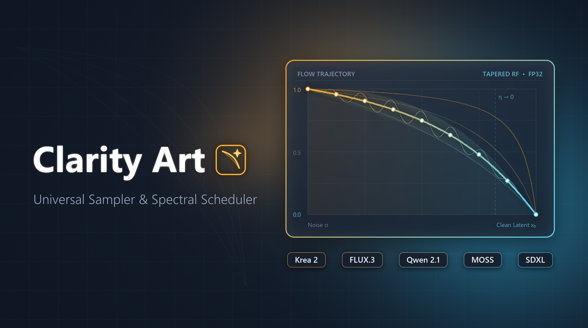

# Clarity Art — Sampler & Scheduler for SD WebUI Forge NEO

  <a href="#english">English</a> • <a href="#русский">Русский</a>

---

## English

**Clarity Art** is a unified paired Sampler and Scheduler for **Stable Diffusion WebUI Forge Neo**, designed for consistent, reliable results across modern and classic models without manual tuning. It automatically detects the loaded architecture (`Krea 2` Turbo/Raw, `FLUX.3`, `MOSS-Image`, `Qwen 2.1`, `FLUX.2 Klein`, `FLUX.1`, `FIBO 2`, `Wan 2.1`, `Z-Image`, `MiniMax H3`, `SDXL` / `SD 1.5`) and applies its native time shift while respecting the `Shift` slider and distilled checkpoint schedules. During early and mid sampling, it preserves natural anatomy, skin texture, and fabric, then smoothly tapers randomness near the end so eyes, fine details, and text resolve cleanly without oversharpening. Sampling adapts automatically to step count — staying clean on short runs, adding detail refinement on longer runs without slowing down, and maintaining high numerical precision at large resolutions. When switching to classic models (`SDXL` / `SD 1.5`, including `img2img` and `Hires Fix`), it automatically engages a refined custom solver built on `DPM++ 2M SDE` — adding smooth end-of-run noise tapering and high-CFG overshoot protection — so you can keep **Clarity Art** selected across checkpoints.

### Installation

1. Open **Extensions → Install from URL** in Stable Diffusion WebUI / Forge Neo (or place this extension inside `extensions/`).
2. Paste the repository URL and click **Install**.
3. Go to **Installed** and click **Apply and restart UI**.
4. Select **Clarity Art** as your Sampler — the paired Scheduler links automatically.

---

## Русский

**Clarity Art** — универсальная связка семплера и шедулера для **Stable Diffusion WebUI Forge Neo**, созданная для стабильного и предсказуемого результата на разных архитектурах без ручного подбора настроек. Расширение автоматически определяет загруженную модель (`Krea 2` Turbo и Raw, `FLUX.3`, `MOSS-Image`, `Qwen 2.1`, `FLUX.2 Klein`, `FLUX.1`, `FIBO 2`, `Wan 2.1`, `Z-Image`, `MiniMax H3`, `SDXL` / `SD 1.5`) и применяет её родной сдвиг времени, не конфликтуя с ползунком `Shift` и не искажая сетку на быстрых дистиллированных чекпоинтах. На ранних и средних шагах генерации семплер сохраняет естественную анатомию, живую фактуру кожи и тканей, а ближе к финалу плавно снижает стохастичность, благодаря чему глаза, мелкие детали и текст выходят чёткими и чистыми без перешарпа. Режим работы сам подстраивается под длину прогона: короткие генерации проходят мягко и без артефактов, многошаговые получают дополнительное уточнение деталей без потери скорости, а расчёты с повышенной точностью исключают поломки цвета и сбои в высоких разрешениях. При переключении на классические модели (`SDXL` / `SD 1.5`, включая `img2img` и `Hires Fix`) автоматически включается собственная усовершенствованная ветка на базе `DPM++ 2M SDE` — с тем же плавным затуханием шума в финале и защитой от перешарпа на высоком CFG, — поэтому можно один раз выбрать **Clarity Art** и не менять семплер при смене чекпоинта.

### Установка

1. Откройте вкладку **Extensions → Install from URL** в Stable Diffusion WebUI / Forge Neo (или скопируйте папку расширения в `extensions/`).
2. Вставьте ссылку на репозиторий и нажмите **Install**.
3. Перейдите во вкладку **Installed** и нажмите **Apply and restart UI**.
4. Выберите семплер **Clarity Art** — парный шедулер подключится автоматически.
